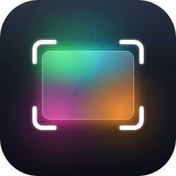

<p align="center">
  
</p>

<h1 align="center">AnyCapture</h1>

<p align="center">
  <strong>Screen capture, screen recording and an image editor for Windows. Free and open source.</strong>
</p>

<p align="center">
  <a href="https://github.com/toim22/AnyCapture/releases/latest"></a>
  
  
  
  <a href="LICENSE"></a>
</p>

<p align="center">
  <a href="https://github.com/toim22/AnyCapture/releases/latest"><strong>Download AnyCapture 0.5.0</strong></a>
  ·
  <a href="https://github.com/toim22/AnyCapture/releases/tag/v0.5.0">What's new</a>
  ·
  <a href="https://github.com/toim22/AnyCapture/issues">Report a bug or share an idea</a>
</p>

---

## Why AnyCapture

Most screenshots need a second step: an arrow, a blurred password, a cropped edge, a quick recording instead of a long
explanation. AnyCapture does all of it in one place. Press **Print Screen**, pick what to capture, and the image opens
in **AnyCapture Editor**, ready to annotate and share.

- **Capture anything.** A region, a window, a scrolling page, a menu, several areas at once, or the text on screen.
- **Record the screen.** MP4 with microphone and system audio, a webcam bubble, clicks and keys on screen.
- **Explain it clearly.** Arrows, callouts, numbered steps, highlights, blur and spotlight, in an editor built for
  screenshots.
- **Light and fast.** Two native Windows programs written in Rust. No account, no subscription, no Visual C++
  runtime to install.
- **Your language.** The whole interface comes in 12 languages and follows Windows' language by default.
- **Always up to date.** AnyCapture checks for new versions and installs them for you after asking.

## Features

### Capture
- Region, window, full screen, monitor, fixed-size region, freehand, multiple areas, the object under the cursor,
  menus, the clipboard and files.
- Scrolling captures: panoramic (you scroll, it stitches), automatic window scrolling and extended windows.
- **Capture text**: recognizes the text in an area (OCR) and copies it. QR codes and barcodes are read too.
- A magnifier and coordinates on the crosshair, a delay with a countdown, cursor capture and keyboard-precise
  selection.
- Presets with their own global shortcuts and outputs: the Editor, the clipboard, a file with an automatic name, an
  external program or text.
- **One Click**: a small panel docked to the edge of the screen that opens when the mouse is over it.
- 12 effects applied as you capture: border, shadow, filters, capture info, watermark, resize, rotate and more.
- Full-screen captures keep **each window as a separate object** and the **links** of web pages as clickable areas,
  also in PDF exports.
- **Pin captures on the screen**, a screen color picker, interval capture, screen focus for presentations, HDR-correct
  colors, Windows 11 rounded corners and command-line automation.

### Screen recording
- MP4 (H.264 + AAC) with microphone and system audio, each with its own volume and mute, and pause without gaps.
- A webcam inside the video (circle, rounded square, square or rectangle, with optional background removal) that you
  can drag while recording.
- Cursor highlight, click rings, keys on screen and a zoom that follows the pointer.
- Hardware encoding, downscaling to 1080p, crash-safe recordings and audio-only recording (M4A or MP3).

### Editor
- Arrow, line, shapes, pen, highlighter, text, callouts, numbered steps, stamps, blur, spotlight, magnifier, fill,
  eraser, eyedropper, crop and cut out.
- A **layers panel**, rulers and guides, exact position and size, align and distribute, and selections that snap to
  edges.
- Smart Move, a magic wand and smart fill: lift a piece of the image, edit the rest and drop it back.
- Beautify, combine and compare images, automatic redaction of sensitive data, background removal, text recognition
  and batch processing.
- Save as PNG, JPG, BMP, GIF, TIFF, WebP, AVIF, PDF or `.snap` (opens HEIC), print, email, or send to Word,
  PowerPoint, Excel and OneNote.
- Video: cut out parts, save a frame, make an animated GIF and export MP4.
- A library of all your captures, with names, search and a larger preview on hover. Recent captures work like File
  Explorer: Shift+click, drag to select and Ctrl+C to copy them as files.
- Optional and off by default: upload to S3, Dropbox, Google Drive, OneDrive, FTP/SFTP or a custom uploader, and an AI
  assistant with your own key.

### Look and languages
- A Windows 11 look in light or dark (*Options › Appearance*) with your Windows accent color.
- English, Portuguese, Chinese (Simplified), Hindi, Spanish, Arabic, French, Bengali, Russian, Indonesian, Urdu and
  German. AnyCapture follows the Windows language (English when there is no translation), and you can change it in
  *File › Options… › Language*.

The complete user manual is [help/AnyCapture-Manual.html](help/AnyCapture-Manual.html). It opens from
*Help › AnyCapture Manual* (**F1**) in both programs.

## Install

1. Download `AnyCapture-0.5.0-setup.exe` from the [latest release](https://github.com/toim22/AnyCapture/releases/latest).
2. Run it. It installs just for you, with no administrator prompt, or for all users if you choose.
3. AnyCapture starts in the notification area. Press **Print Screen** to capture.

The installer adds AnyCapture to the Start menu, can start it with Windows, and uninstalls from *Settings › Apps*.
Your captures and settings are kept when you uninstall. Installing over Snapnab 0.4 replaces it and brings your
captures and settings along.

Prefer no installation? Download `AnyCapture-0.5.0-win-x64.zip`, extract it to any folder and run `AnyCapture.exe`.

**Requirements:** Windows 10 version 2004 or later, or Windows 11, 64-bit.

> Windows may show "Windows protected your PC" because AnyCapture isn't digitally signed yet. Click
> **More info › Run anyway**.

## Usage

| Shortcut | Action |
| --- | --- |
| `Print Screen` | Capture an image |
| `Shift+Print Screen` | Record a video (press again to stop) |
| `Shift+F9` | Pause or resume the recording |
| `Shift+F10` | Stop the recording |
| `Esc` | Cancel the selection |

You can change the shortcuts in *Options*. From the command line:

```text
AnyCapture.exe        /capture | /video | /preset "name" | /clipboard | /hide | /exit | /help
AnyCaptureEditor.exe  /Open "file" | /NewFromClipboard | /help
```

### Your data

| What | Where |
| --- | --- |
| Captures and videos | `%LOCALAPPDATA%\AnyCapture\Library` |
| Presets | `%LOCALAPPDATA%\AnyCapture\Presets1.xml` |
| Editor themes, quick styles, favorites, quick effects, stamp order | `%LOCALAPPDATA%\AnyCapture\*.xml` |
| Settings backups | `%LOCALAPPDATA%\AnyCapture\Backups` |
| Logs | `%LOCALAPPDATA%\AnyCapture\Logs` |
| Settings | `HKEY_CURRENT_USER\Software\AnyCapture` |

Your captures stay on your computer. What goes online, and when, is listed in the [privacy policy](#privacy-policy).

## Build from source

You need [Rust](https://rustup.rs) (stable, MSVC toolchain) and the Visual Studio 2022 or later C++ build tools (the
MSVC linker, `rc.exe` and the Windows SDK). To build the installer you also need
[Inno Setup](https://jrsoftware.org/isinfo.php) 6.7 or later.

```bat
build.bat
```

```bat
cargo test --release --workspace --manifest-path rust/Cargo.toml
```

The programs end up in `dist\AnyCapture\`, the portable package in `dist\AnyCapture-<version>-win-x64.zip` and the
installer in `dist\AnyCapture-<version>-setup.exe`. Details, the end-to-end tests and the installer are in
[docs/BUILDING.md](docs/BUILDING.md).

| Folder | What's inside |
| --- | --- |
| `rust/snapcore` | The library both programs share: documents, library, images, effects, capture, video |
| `rust/snapui` | The egui window host and the shared windows, forms and controls |
| `rust/anycapture` | `AnyCapture.exe`: capture and recording |
| `rust/snapedit` | `AnyCaptureEditor.exe`: the Editor |
| `rust/snapex` | `SnapEx64.dll`: extended window capture |
| `rust/snaptool` | `AnyCaptureTool.exe`: a test and debugging helper (not shipped) |
| `rust/resources` | Icons, fonts, manifest and version resources |
| `services/issue-relay` | The Cloudflare Worker that files problem reports on GitHub |
| `tests` | End-to-end tests (`tests/e2e`) and the reference data of the Rust tests |
| `help` | The user manual |
| `lang` | Interface translations (gettext `.po` files and the `anycapture.pot` template) |
| `packaging` | The installer script and pictures |
| `scripts` | Development utilities, such as `i18n.py` for the translations |
| `docs` | Architecture, build instructions and images |

The architecture is described in [docs/ARCHITECTURE.md](docs/ARCHITECTURE.md), and the version history in
[CHANGELOG.md](CHANGELOG.md).

## Project status

AnyCapture **0.5.0** is the first full release. It is the former Snapnab, renamed and rewritten from C++ to Rust with
the same features and files. See the [changelog](CHANGELOG.md) for everything that changed. Known limits:

- The programs aren't code-signed yet, so Windows shows a warning the first time you run them.
- A few things work differently from the C++ version, for example the named Beautify presets of a capture preset are
  edited in a plain form. They're listed under "Rust rewrite: decisions to review" in
  [docs/ARCHITECTURE.md](docs/ARCHITECTURE.md).

## Feedback

Use **Help › Report a problem…** or **Help › Send a suggestion or feedback…** in AnyCapture or the Editor. You don't
need a GitHub account: the form files the issue for you and shows its link. You can also open an
[issue](https://github.com/toim22/AnyCapture/issues) yourself.

## Code signing policy

Free code signing provided by [SignPath.io](https://about.signpath.io/), certificate by
[SignPath Foundation](https://signpath.org/).

Only the official releases published on this repository's *Releases* page are signed. Every signed file is built by the
[Build workflow](.github/workflows/build.yml) on GitHub Actions directly from the public source code of this repository;
nothing built on a personal computer is signed. Each signing request is approved manually before it is processed.

| Role | Members |
| --- | --- |
| Committers and reviewers | [toim22](https://github.com/toim22) |
| Approvers | [toim22](https://github.com/toim22) |

The signed files are `AnyCapture.exe`, `AnyCaptureEditor.exe`, `SnapEx64.dll` and the installer
`AnyCapture-<version>-setup.exe`. The SHA-256 hashes of the release packages are published with each release.

### Privacy policy

This program will not transfer any information to other networked systems unless specifically requested by the user or
the person installing or operating it. AnyCapture has no telemetry and no online account. It goes online only in these
cases:

- **Update check.** Shortly after it starts, and when you choose *Help › Check for updates…*, AnyCapture asks GitHub
  for the latest release, sending only its version number. You can turn the automatic check off in
  *Options › Updates*.
- **Problem reports and suggestions.** Only when you click *Send* in *Help › Report a problem…* or
  *Help › Send a suggestion or feedback…*. What you wrote (and, if you leave that box checked, your Windows version and
  interface language) goes through the AnyCapture relay on Cloudflare and becomes a **public** issue on this
  repository. Your IP address is used to limit how many reports can be sent per minute and never appears in the issue;
  Cloudflare keeps the relay's request logs for a few days.
- **Links and email.** A link you open goes to your default browser, and a capture you send by email goes to your
  email program.
- **Upload and the AI assistant**, both off until you set them up: upload sends captures to the storage you configure,
  and the AI assistant sends the image and your question to the provider you choose, with your own key. Their secrets
  stay in the Windows Credential Manager.

See [Your data](#your-data) for what is stored on your computer.

## License

Copyright © 2026 Antonio Rezende.

AnyCapture is free software: you can use, study, modify and redistribute it under the terms of the
[GNU General Public License version 3](LICENSE). Modified versions that are distributed must also have their
source code open under the same license. The program is provided without warranty of any kind.
