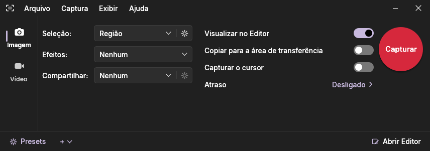

# AnyCapture

**Screen capture, video recording and image editor for Windows.**



AnyCapture lives in the notification area: press **Print Screen**, choose what to capture and the image opens in
**AnyCapture Editor**, ready to annotate, highlight and share. It also records the screen as MP4, with microphone and system audio.

## Features

**Capture**
- Region, window, full screen, monitor, fixed-size region, freehand, multiple areas, object under the cursor,
  panoramic scrolling (you scroll, it stitches), automatic window scrolling, extended window, menus, clipboard and file
- **Capture text**: recognizes the text in the region (OCR) and copies it to the clipboard
- Magnifier and coordinates on the crosshair, delay with a countdown, cursor capture
- Presets with global hotkeys and outputs: Editor, clipboard, file with an automatic name, external program, text
- **One Click**: a discreet panel docked to the edge of the screen that opens when the mouse is over it (*View › Show One Click*)
- 12 effects applied on capture: border, filters, shadow, capture info, color replacement, resize,
  edge effects, trim edges, color adjustment, rotate, watermark and resolution
- Full-screen captures with **each window as a separate object**, and the **links** of web pages and documents kept as
  clickable areas (also in PDF exports)
- Every capture copied to the clipboard, a quick thumbnail after capturing, **pin captures on the screen**, screen color
  picker, region history and keyboard-precise selection, HDR-correct captures, Windows 11 rounded corners, interval
  capture, screen focus, QR code reading and command-line automation (`/region`, `/window`, `/output`…)

**Video recording**
- MP4 (H.264 + AAC), microphone and system audio with separate mute and volume (automatic or manual microphone gain),
  pause without gaps in the video
- Webcam inside the video (circle, rounded square, square or rectangle, with optional background removal), which can
  be dragged during the recording
- Control panel and frame that do not show up in the recording, downscaling to 1080p, hardware encoding
- Cursor highlight, click rings and keys on screen, zoom that follows the pointer, crash-safe recording, audio-only
  recording (M4A/MP3)

**Editor**
- Arrow (with a text label at the tail), line, shapes, pen, highlighter, text, callouts (with frosted-glass
  background), numbered steps, stamps (including Before/After and other labels), blur, spotlight, magnifier
  (also a realistic loupe), fill, eraser, eyedropper, crop and cut out
- Shift draws perfect squares, circles and 45° lines in every tool; highlighter, spotlight and blur also as an ellipse,
  polygon or freehand outline; gradient fills
- **Layers panel** (hide, lock, rename and reorder objects), rulers and guides, exact X/Y/width/height, align and
  distribute, paste in place, selection and crop that snap to edges
- Selection with Smart Move, magic wand and smart fill; lift a piece, edit the rest and drop it back; undo/redo
- Image effects, text recognition (OCR), save as PNG, JPG, BMP, GIF, TIFF, WebP, AVIF, PDF and `.snap` (opens HEIC),
  print and email
- Beautify, combine and compare images, redact sensitive data automatically, smart highlighter and text-only blur,
  draw-and-hold shapes, hand-drawn style, vertical text and text along a line, cursor and date stamps, background
  removal, split image, contrast checker, batch processing, *Copy as…*, send to Word/PowerPoint/Excel/OneNote
- Optional (off by default): upload to S3, Dropbox, Google Drive, OneDrive, FTP/SFTP or a custom uploader, and an AI
  assistant with your own key
- Video: cut out parts, save a frame, create an animated GIF and export MP4
- Library with all your captures: names, search, a larger preview on hover
- Export and import all settings in one file, with an automatic weekly backup

**Languages**
- English, Portuguese, Chinese (Simplified), Hindi, Spanish, Arabic, French, Bengali, Russian, Indonesian, Urdu and
  German; follows the Windows language (English if there is no translation) and can be changed in *File › Options… › Language*

The capture window follows the accent color chosen in *Settings > Personalization > Colors*.

The complete user manual is [help/AnyCapture-Manual.html](help/AnyCapture-Manual.html); it opens from *Help › AnyCapture Manual*
(**F1**) in both programs.

## Installation

Requires **Windows 10 version 2004 or later, or Windows 11 (64-bit)**. No extra runtime is needed.

- **Portable:** download `AnyCapture-<version>-win-x64.zip` from the *Releases* page, extract it to any folder and open `AnyCapture.exe`.
- **Installer:** open `AnyCapture-<version>-setup.exe` and follow the wizard. It installs just for you (no administrator
  prompt) or for all users, creates the Start menu shortcuts, can start AnyCapture with Windows and
  uninstalls from *Settings › Apps*. Your captures and settings are kept when uninstalling.

## Usage

| Shortcut | Action |
|---|---|
| `Print Screen` | capture an image |
| `Shift+Print Screen` | record a video (again to stop) |
| `Shift+F9` | pause / resume the recording |
| `Shift+F10` | stop the recording |
| `Esc` | cancel the selection |

The shortcuts can be changed in *Options*. Command line:

```text
AnyCapture.exe        /capture | /video | /preset "name" | /clipboard | /hide | /exit | /help
AnyCaptureEditor.exe  /Open "file" | /NewFromClipboard | /help
```

### Your data

| What | Where |
|---|---|
| Captures and videos | `%LOCALAPPDATA%\AnyCapture\Library` |
| Presets | `%LOCALAPPDATA%\AnyCapture\Presets1.xml` |
| Editor themes, quick styles, favorites, quick effects, stamp order | `%LOCALAPPDATA%\AnyCapture\*.xml` |
| Settings backups | `%LOCALAPPDATA%\AnyCapture\Backups` |
| Logs | `%LOCALAPPDATA%\AnyCapture\Logs` |
| Settings | `HKEY_CURRENT_USER\Software\AnyCapture` |

Nothing is sent to the internet.

## Building from source

With [Rust](https://rustup.rs) and the Visual Studio 2022+ C++ build tools (the MSVC linker, `rc.exe` and the Windows
SDK):

```bat
build.bat
```

The program ends up in `dist\AnyCapture\` and the package in `dist\AnyCapture-<version>-win-x64.zip`. Details, tests and the
installer are in [docs/BUILDING.md](docs/BUILDING.md).

## Repository layout

```text
rust/                   source code (Rust workspace)
  snapcore/             library shared by both programs (documents, library, images, effects, capture, video…)
  snapui/               egui window host and shared windows and forms
  anycapture/              AnyCapture.exe — capture and recording
  snapedit/             AnyCaptureEditor.exe — editor
  snapex/               SnapEx64.dll — extended window capture
  snaptool/             AnyCaptureTool.exe — test and debugging helper (not shipped)
  resources/            icons, manifest and version resources
tests/                  end-to-end tests (tests/e2e) and the reference data of the Rust tests (tests/data)
help/                   user manual (AnyCapture-Manual.html, opened by Help › AnyCapture Manual and F1)
lang/                   interface translations (gettext: <language>.po and the anycapture.pot template)
packaging/              package files and installer script
scripts/                development utilities (i18n.py extracts and checks the translations)
docs/                   architecture, build and images
```

The architecture and its mapping to the reference documents are in [docs/ARCHITECTURE.md](docs/ARCHITECTURE.md).
The version history is in [CHANGELOG.md](CHANGELOG.md).

## Code signing policy

Free code signing provided by [SignPath.io](https://about.signpath.io/), certificate by
[SignPath Foundation](https://signpath.org/).

Only the official releases published on this repository's *Releases* page are signed. Every signed file is built by the
[Build workflow](.github/workflows/build.yml) on GitHub Actions directly from the public source code of this repository;
nothing built on a personal computer is signed. Each signing request is approved manually before it is processed.

| Role | Members |
|---|---|
| Committers and reviewers | [toim22](https://github.com/toim22) |
| Approvers | [toim22](https://github.com/toim22) |

The signed files are `AnyCapture.exe`, `AnyCaptureEditor.exe`, `SnapEx64.dll` and the installer `AnyCapture-<version>-setup.exe`.
The SHA-256 hashes of the release packages are published with each release.

### Privacy policy

This program will not transfer any information to other networked systems unless specifically requested by the user or
the person installing or operating it. AnyCapture has no telemetry, update check or online account; the only network
activity happens when you open a link yourself (it opens in your default browser), choose to send a capture by email
(it is handed to your email program), or turn on one of the two optional online features: **upload** (to the storage
you configure) and the **AI assistant** (the image and your question go to the provider you choose, with your own
key). Both are off until you set them up; their secrets stay in the Windows Credential Manager. See
[Your data](#your-data) for what is stored on your computer.

## License

Copyright © 2026 Antonio Rezende.

AnyCapture is free software: you can use, study, modify and redistribute it under the terms of the
[GNU General Public License version 3](LICENSE). Modified versions that are distributed must also have their
source code open under the same license. The program is provided without warranty of any kind.
